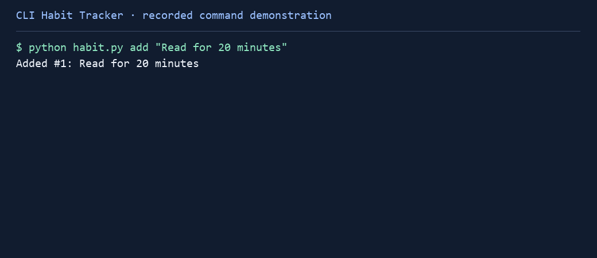

# CLI Habit Tracker

A command-line app for tracking daily habits and streaks.

## Try it in your browser

[](https://codespaces.new/TSalim22/cli-habit-tracker?quickstart=1)

Sign in to GitHub, open a Codespace and wait for setup. Then run this in its terminal:

```sh
python habit.py --help
```

Codespaces uses your GitHub account’s allowance. Stop it when finished.

## Run it

Python 3.12 or later. Run these commands from the project folder:

```powershell
python -m venv .venv
.venv\Scripts\Activate.ps1
python -m pip install -r requirements-dev.txt
python habit.py --help
```

On macOS or Linux, activate with `source .venv/bin/activate` instead.

## How to use it

```sh
python habit.py add "Read for 20 minutes"
python habit.py list
python habit.py check 1
python habit.py stats
python habit.py uncheck 1
python habit.py delete 1 --yes
```

Habits are saved in `data/habits.json`. Use `--date YYYY-MM-DD` to record an earlier day. The same day is only counted once.



## Tests

```sh
python -m pytest -q
```
